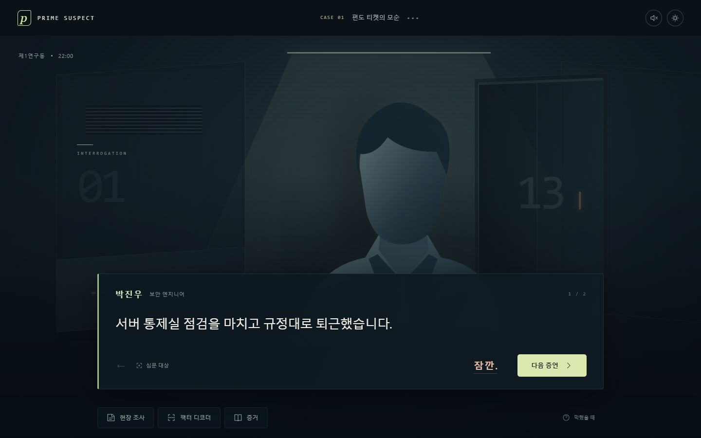

# PRIME SUSPECT — 유일한 흔적 · UI v2

소인수분해로 키카드의 출입 기록을 분석하고, 거짓 증언을 논파하는 한국어 추리 어드벤처입니다. 네 사건을 끝까지 플레이할 수 있으며, 인물과 한 문장을 중심으로 대화를 진행합니다.



## 실행

압축을 풀고 **Start-Game.cmd** 또는 **index.html**을 여세요. 별도 설치, 인터넷, npm, 계정, API 키가 필요하지 않습니다. index.html만 따로 옮기지 말고 폴더 전체를 함께 보관하세요. 브라우저는 최신 버전을 권장하며, Chromium 기반 미리보기에서 검증했습니다.

**PrimeSuspect.html**은 CSS와 스크립트를 모두 포함한 단일 파일입니다. 이 파일은 따로 옮겨서 열어도 됩니다. 수정 및 에셋 교체는 원본 index.html과 개별 소스 파일을 기준으로 진행하세요.

모바일 브라우저에서 플레이하려면 폴더 전체를 정적 웹 서버에 올려 접속하세요. 개발 PC에서 미리보기할 경우 이 폴더에서 `python -m http.server 4173 --bind 127.0.0.1`로 실행한 뒤 `http://127.0.0.1:4173`을 여세요. 휴대폰에서 직접 실행하는 네이티브 APK/IPA는 포함되어 있지 않습니다.

## 플레이

1. **다음 증언**으로 한 문장씩 듣습니다. 대화창의 **심문 대상**에서 용의자를 바꿉니다.
2. 의심되는 말에서 **잠깐.**을 누르면 그 증언을 멈춰 세웁니다.
3. 아래 **현장 조사** 또는 **팩터 디코더**를 엽니다. 도구는 한 번에 하나만 나타납니다. **심문으로** 또는 Esc로 닫으면 멈췄던 증언으로 돌아옵니다.
4. 카드를 선택해 스캔하고, 지도에서 필요한 방만 조사합니다. 다른 사람의 카드를 분석해도 심문 대상은 바뀌지 않습니다.
5. **증거를 고른다**에서 필요한 1~2개 증거를 선택해 제시합니다. 자세한 설명은 각 증거의 **상세**에 있습니다.
6. 동선 재구성은 별도의 선택 턴으로 진행합니다. 맞는 추리를 고른 다음 그 추리를 뒷받침할 증거를 제시합니다.
7. Case 2의 익명 스냅샷도 한 장씩 배정합니다. Case 3의 공약수와 스왑, Case 4의 ±1 보정은 디코더 안의 모듈로 사용합니다.

사건 도입과 논파 결과는 짧은 장면으로 나뉩니다. 화면 위 사건 제목을 누르면 사건 기록과 해금 상태를 볼 수 있습니다. 기존 v1 저장 데이터도 이어서 사용할 수 있습니다.

오답에 횟수 제한은 없으며, 3단계 힌트를 제공합니다. 수사 노트에서 모든 수집 증거와 이미 해결한 추론을 다시 읽을 수 있습니다. 사운드는 오른쪽 위에서 켭니다. 기기 설정의 모션 줄이기를 따릅니다. 버튼은 키보드로 조작할 수 있고, 탭 목록은 좌우 방향키도 지원합니다. 스왑은 드래그와 버튼을 모두 제공합니다.

## 저장

같은 브라우저와 같은 주소의 localStorage에 자동 저장합니다. 브라우저 데이터를 지우면 진행이 사라집니다. 시크릿 모드나 저장을 제한하는 환경에서는 저장되지 않을 수 있으며 화면에 안내합니다. 파일로 실행한 진행과 서버 주소로 실행한 진행은 별개입니다. 설정에서 초기화할 수 있습니다. 완료한 사건을 다시 수사해도 다음 사건의 해금 상태는 유지됩니다.

## 이미지와 사운드 교체

`assets/manifest.js` 한 곳에서 에셋 경로를 지정합니다. 이미지가 없으면 기본 실루엣을 사용합니다. 외부 이미지·폰트·음원을 내려받지 않고 실행됩니다.

예를 들어 `assets/portraits/han.webp`를 넣고 `han: 'assets/portraits/han.webp'`로 바꾸면 한도윤 초상이 교체됩니다. 권장 초상은 세로 3:4 또는 1:1, 얼굴이 위쪽 중앙에 있는 PNG/WebP입니다. 이름이나 UI 문구를 이미지에 넣지 마세요. 이미지 영역은 화면에 따라 크롭됩니다.

인물 ID: `park` 박진우, `choi` 최유리, `han` 한도윤, `kim` 김태호, `lee` 이서연, `kang` 강현우, `oh` 오민석, `jung` 정하늘, `song` 송지훈, `yoon` 윤채원, `baek` 백도현.

`backgrounds.lab`은 연구소 배경, `audio.scan`, `audio.success`, `audio.error`는 각 효과음입니다. 음원 경로가 비어 있으면 브라우저가 짧은 효과음을 합성합니다. 사용자 입력 전에는 소리를 재생하지 않습니다.

## 구성

- `index.html`: 진입점
- `styles.css`: 대화 장면, 필요할 때 여는 조사 화면, 작은 화면 대응
- `cases.js`: 네 사건의 대사, 지도, 단서, 단계별 정답과 힌트
- `core.js`: 소인수분해·최대공약수·몫·스냅샷 매칭·스왑·제시 검증
- `game.js`: 화면, 진행, 저장, 상호작용
- `assets/manifest.js`: 나중에 전달받을 에셋 연결
- `scripts/build.cjs`: 수정한 소스를 단일 HTML로 묶기
- `tests/core.test.cjs`: 카드 계산 및 논파 조건 검증

## 개발 및 검증

게임 실행에는 Node.js가 필요하지 않습니다. 아래 개발 명령은 Node.js 18 이상에서 별도 패키지 설치 없이 실행할 수 있습니다.

```sh
# 카드 계산, 스냅샷 매칭, 스왑, 논파 조건 검증
node tests/core.test.cjs

# 소스를 수정한 뒤 단일 실행 파일 다시 만들기
node scripts/build.cjs
```

`index.html`은 소스를 바로 읽습니다. `PrimeSuspect.html`에는 빌드 시점의 코드가 들어 있으므로, 소스나 에셋 경로를 수정한 뒤에는 위 빌드 명령으로 갱신하세요. 실제 이미지와 음원은 별도 파일이며, 해당 에셋을 사용할 때에는 `assets` 폴더도 함께 보관해야 합니다.

<details>
<summary>설계 메모 · 사건 스포일러 포함</summary>

## 기획서에서 정리한 부분

- Case 4의 해치 출구는 **게이트 3 안쪽 엘리베이터 홀**로 통일했습니다. 따라서 최종 카드 `2⁴ × 3² × 7 = 1,008`과 실제 이동이 일치합니다.
- Case 4의 레버는 정문을 봉쇄하며 별도 카드 인수를 곱하지 않습니다. `×7`은 제어실 진입 게이트에서 한 번만 기록합니다.
- 소인수분해로 알 수 있는 것은 통과 횟수입니다. 최종 곱만으로 방문 순서나 정확한 시각, 카드 소지자를 결정할 수 없음을 안내합니다.
- 공약수는 공통 기록을 보여 줍니다. 접선 여부는 망막 인증과 지도 및 카드 교환의 모순을 함께 사용해 판단합니다.
- ±1 오염은 이 게임의 가상 장치 설정이며, 실제 비트 반전의 일반적 성질로 설명하지 않습니다.

완성 아트, 녹음 대사, 배경 음악, 네이티브 모바일 패키징은 후속 교체·확장 대상입니다. 현재는 내장 그래픽과 합성 효과음으로 네 사건의 플레이 흐름을 제공합니다.

</details>
